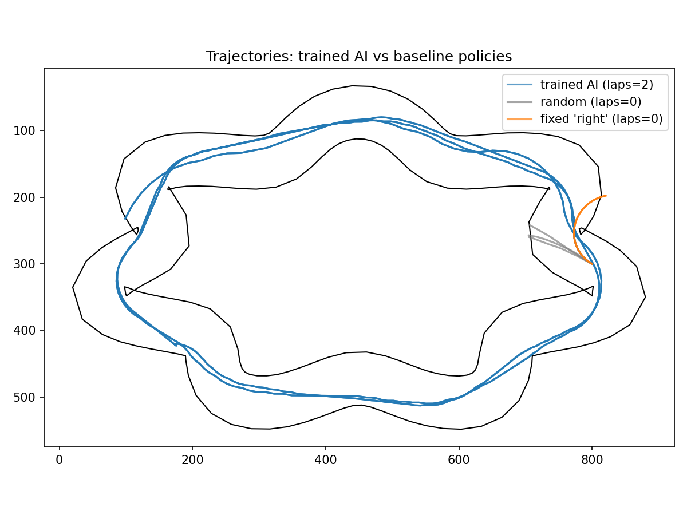

# Self-Driving Car Simulation — 2D Track + Neuroevolution

A 2D car simulation where a small neural network learns to drive around a
track, trained from scratch with a genetic algorithm and with a gradientdescent algorithm (no TensorFlow/PyTorch
required — just NumPy). Built as a learning project to understand both
Python fundamentals and how reinforcement learning actually fits together,
step by step.



## What's in here

The car, the track, the RL environment, the network, and the training
algorithm are all separate, small modules:

| File | What it does |
|---|---|
| `config.py` | Every tunable parameter (car physics, track shape, network size, GA hyperparameters, where a run starts from). Change behavior here, not in the other files. |
| `car.py` | `Car` class — physics only (position, speed, steering), no rendering. |
| `track.py` | `Track` class — two boundary polylines (inner/outer wall), sensor ray-casting, checkpoint progress tracking. Includes 4 track shape generators (oval, wavy, rounded rectangle, pinched loop). |
| `env.py` | `CarEnv` — wraps `Car` + `Track` behind a `reset()`/`step(action)` interface (the standard RL environment shape). This is what the neural network actually talks to. |
| `neural_network.py` | A small feedforward network in plain NumPy (7 inputs → hidden layer → 5 actions). |
| `genetic_algorithm.py` | `Population` (evaluates networks, breeds the next generation) and `HallOfFame` (keeps the top all-time-best networks, used as the parent pool every generation). |
| `simulation.py` / `main.py` | Manual keyboard-controlled play (arrow keys / WASD), for testing the physics and track by hand. |
| `train.py` | Runs the genetic algorithm. No command-line arguments — everything is controlled from `config.py`, so it also runs fine from an IDE's "Run" button (e.g. Spyder). |
| `watch_best.py` | Loads the best trained network and watches it drive, rendered with pygame. |
| `evaluate.py` | Runs the trained network over many episodes and reports aggregate metrics (success rate, off-track rate, average laps). |
| `plot_trajectories.py` | Saves `trajectories.png`, comparing the trained AI's path against baseline policies. |

## Setup

```bash
pip install -r requirements.txt
```

## Usage

```bash
python main.py              # manual play - drive with arrow keys / WASD
python train.py              # train a population via the genetic algorithm
python train_gradient.py     # train a population via the gradient descent algorithm
python watch_best.py         # watch the best trained network drive
python evaluate.py           # print performance metrics over many episodes
python plot_trajectories.py  # save a trajectory comparison plot
```

Training saves two things as it goes:
- `best_weights.npy` — the single best network found (what `watch_best.py` and `evaluate.py` load)
- `hall_of_fame.npz` / `hall_of_fame.txt` — the top `HOF_SIZE` networks ever found, updated every generation

To continue training from a previous run instead of starting fresh, set
`START_MODE = "hall_of_fame"` in `config.py` and run `train.py` again. (same for both algorithms)

## How it works, briefly

- **State** (what the network sees): one distance per sensor (rays cast to
  the track walls; their number and angles are set by `SENSOR_ANGLES_DEG`
  in `config.py`), the car's current speed, and the angle between the car's
  heading and the direction of the track at its position. That is
  `number of sensors + 2` values, each normalized to roughly `[-1, 1]`.
- **Actions**: 5 discrete choices (accelerate straight / left / right, brake,
  coast).
- **Progress & reward**: there are no checkpoints. Each step, the car's
  position is projected onto the nearest point of the track's centerline,
  and the forward distance travelled along the track is the main reward
  signal. Because only forward progress counts, not the car's sideways
  position, the car is free to cut corners and hug the inside line. There is
  also a small per-step penalty (to discourage idling), a bonus for each lap
  completed (counted once per lap, from the furthest point reached, so
  wiggling back and forth over the start line earns nothing), and a penalty
  plus episode end for driving off-track. All values are in `config.py`.
- **Training**: two interchangeable methods, both configured entirely from
  `config.py`, using the same network and the same environment:
  - **Genetic algorithm** (`train.py`): no backpropagation. A population of
    networks is evaluated by total reward per episode, and the next
    generation is bred (crossover + mutation) from a Hall of Fame holding
    the best distinct networks ever found, not just the last generation's
    winners. The Hall of Fame is saved every generation, so a run can be
    stopped and continued later with `START_MODE`.
  - **Policy gradient / REINFORCE** (`train_gradient.py`): gradient descent.
    The network outputs action probabilities and the car samples its actions
    from them. After each batch of episodes, the weights are adjusted by
    backpropagation so that actions followed by above-average returns become
    more likely (with an entropy bonus to keep exploring, gradient clipping
    for stability, and the Adam optimizer). The greedy policy (always the
    highest-scoring action) is tested after each update, and the best
    weights are saved. Settings are the `PG_*` values in `config.py`.
- **Evaluation**: both methods save the best network to `best_weights.npy`,
  which `watch_best.py`, `evaluate.py` and `plot_trajectories.py` load. This
  means running one trainer overwrites the other's result, so rename the
  file first if you want to keep it.

## Track shapes

Four shapes are available out of the box (`config.TRACK_SHAPE`): `"oval"`,
`"wavy"`, `"rounded_rect"`, `"pinched"`. See the comments in `config.py` for
each shape's parameters. The track can be driven both ways.

## License

MIT — see `LICENSE`.
